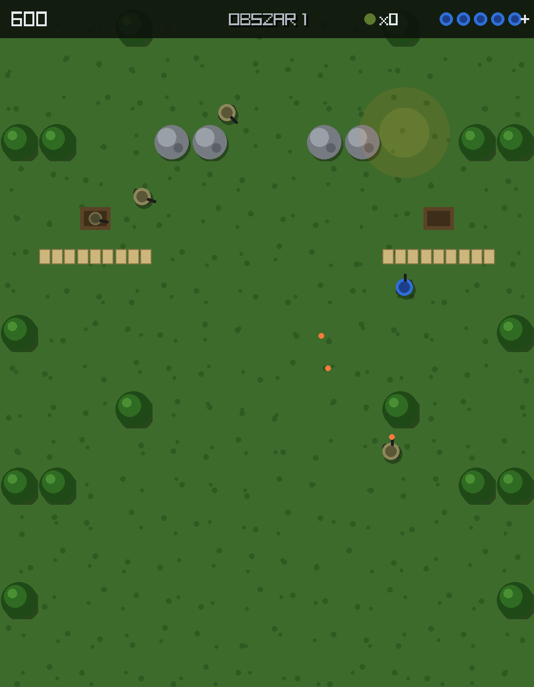
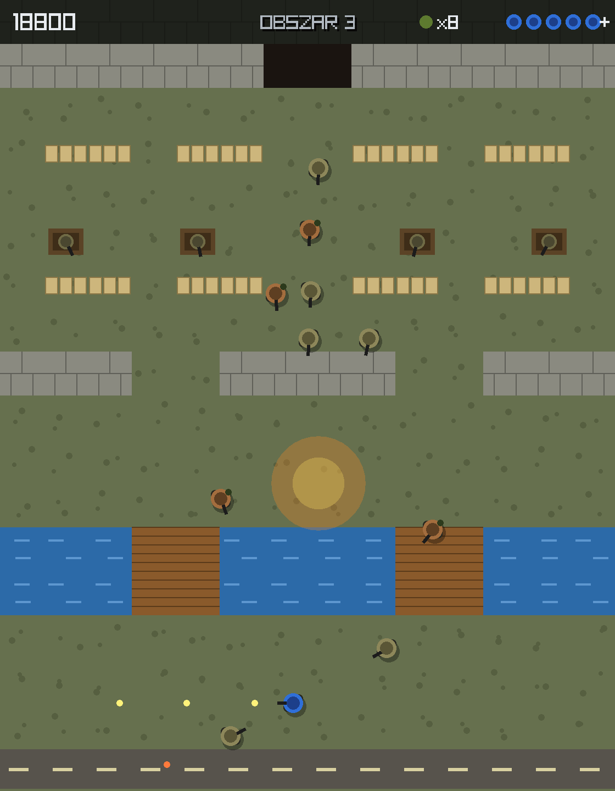

# Commando w Ducklingu

Gra akcji z widokiem z góry na wzór automatu Commando (Capcom, 1985), napisana w Ducklingu. Żołnierz przedziera się sam przez trzy obszary: dżunglę, kanion i twierdzę. Ekran przewija się w górę, gdy idziesz naprzód. Na końcu każdego obszaru czeka brama, z której wybiega fala żołnierzy.

Okno, klawiatura, rysowanie i dźwięk pochodzą z pakietu `grafika` (raylib 5.5) z [duckling-biblioteki](https://github.com/andr729/duckling-biblioteki). Cała grafika jest rysowana kształtami w kodzie, a dźwięki generuje skrypt w `narzedzia/`, więc w repozytorium nie ma cudzych materiałów.





## Sterowanie

| Klawisz | Działanie |
|---|---|
| strzałki albo W A S D | ruch w 8 kierunkach |
| spacja albo Z (trzymane) | strzał z karabinu |
| X albo C | granat |
| P | pauza |
| M | dźwięk włącz / wyłącz |
| R | nowa gra |
| Esc albo zamknięcie okna | wyjście |

## Zasady

Tak jak w oryginale:

* **Karabin** strzela w tę stronę, w którą patrzy żołnierz (8 kierunków), i ma nieograniczoną amunicję. Kula leci jednak tylko około pół ekranu (300 px). Naraz w powietrzu mogą być najwyżej 4 kule.
* **Granaty** zawsze lecą w górę ekranu, niezależnie od tego, gdzie patrzy żołnierz:
  * lecą 200 px, nad skałami, workami z piaskiem i wodą;
  * wybuch zabija wszystkich w promieniu;
  * na starcie jest ich 6, a skrzynka daje 4 kolejne;
  * zapas granatów nie przepada po śmierci.
* **Przewijanie:** ekran jedzie w górę, gdy żołnierz przekroczy próg w górnej części ekranu. W dół nigdy nie wraca.
* **Teren:**
  * skały, drzewa, mur i woda zatrzymują marsz;
  * przez rzekę prowadzą mosty;
  * skały, drzewa i mur zatrzymują wszystkie kule;
  * worki z piaskiem zatrzymują kule gracza, ale wrogowie strzelają znad nich.
* **Brama:** gdy ekran dojedzie do końca obszaru, staje. Oficer wychodzi z bramy i od razu ucieka w bok; trafienie go w plecy to premia. Z bramy wybiega 6 + 2 × numer obszaru żołnierzy. Po pokonaniu wszystkich obszar jest zdobyty i po 3 s zaczyna się następny.
* **Życia:** są 3 na start, a dodatkowe przy 10 000 punktów i potem co 50 000. Kula wroga, wybuch granatu wroga albo dotknięcie wroga zabija. Po śmierci żołnierz wraca na dół ekranu z chwilą nietykalności, a kule i granaty wroga znikają.
* **Trudność:** po trzech obszarach mapy wracają od początku, a wrogowie są szybsi, strzelają częściej i jest ich więcej.

**Wrogowie i punkty:**

| Kto | Co robi | Punkty |
|---|---|---|
| żołnierz | wbiega z góry lub z boku, idzie w stronę gracza i strzela | 100 |
| granatnik | zatrzymuje się w zasięgu i rzuca granat tam, gdzie stoisz | 150 |
| strzelec w okopie | stoi za workami z piaskiem; **kule go nie biorą, tylko granat** | 300 |
| motocykl | przejeżdża drogą; potrzebuje dwóch trafień | 500 |
| strażnik konwoju | prowadzi jeńca przez ekran | 200 |
| oficer | ucieka z bramy | 2000 |
| uwolniony jeniec | po zabiciu strażnika podejdź do niego | 1000 |
| zdobycie obszaru | | 3000 |

## Jak to działa

* **Mapy:** każdy obszar to lista napisów po 14 znaków (kafle 40 px). Wiersz 0 to mur z bramą, a gracz zaczyna na dole. Znaki oznaczają teren (`#` skała, `T` drzewo, `=` worki, `~` woda, `H` most, `-` droga, `W` mur, `G` brama) albo obiekty (`S` strzelec w okopie, `N` granatnik, `R` trzech żołnierzy, `M` motocykl, `J` konwój z jeńcem, `g` skrzynka). Obiekty z wiersza wchodzą do gry, gdy wiersz pojawia się nad ekranem.
* **Sprawdzanie map:** `narzedzia/mapy.py` sprawdza mapy i generuje z nich kod Ducklinga: szerokość wierszy, osiągalność skrzynek i to, czy od startu da się dojść pod bramę, omijając okopy. To samo sprawdza test w Ducklingu.
* **Stały krok:** gra liczy się krokami 1/60 s, a czas klatki tylko je odmierza. Przy 30 i przy 120 klatkach na sekundę wychodzi ten sam stan. Granat naciśnięty w bardzo krótkiej klatce czeka na następny krok, więc się nie gubi.
* **Losowanie:** generator xorshift64* ma ziarno w stanie gry. To samo ziarno i te same klawisze dają zawsze tę samą grę, więc testy mogą rozgrywać całe minuty.
* **Zderzenia z terenem:** kwadrat 20 × 20 px, ruch osobno w osi X i Y. Dzięki temu żołnierz ślizga się wzdłuż skały, zamiast się zatrzymać.

## Uruchomienie (macOS)

```sh
./uruchom.sh          # pierwszy raz przygotowuje raylib i grafikę (~1 min), potem buduje i uruchamia grę
./uruchom.sh testy    # testy logiki, bez okna
```

Wymagania:
* Duckling z `duck` w PATH (sprawdzone na `duckc 0.3-alpha (83882805a 2026-11-20)`, macOS 27.2, Apple Silicon);
* Xcode Command Line Tools (git, make, clang);
* duckling-biblioteki, gałąź `paczki-duck`, domyślnie w `~/duckling-biblioteki` (inna ścieżka: `./przygotuj_macos.sh /ścieżka`).

Okno potrzebuje aktywnego ekranu. Jeśli program startuje przez SSH albo skrypt, gdy ekran Maca śpi lub jest zablokowany, raylib nie dostaje kontekstu OpenGL i `InitWindow` kończy się błędem segmentacji. Pomaga wybudzenie ekranu na czas działania programu:

```sh
caffeinate -u -d -t 60 & sleep 2; ./uruchom.sh
```

## Struktura

```
logika/       pakiet commando_logika: teren, gracz, wrogowie, kule, granaty, brama, mapy
gra/          pakiet commando_gra: okno, klawiatura, rysowanie, dźwięk, pętla gry
gra/dzwieki/  dźwięki WAV wygenerowane przez narzedzia/dzwieki.py
testy/        pakiet testy_commando: 69 sprawdzeń bez okna, kod wyjścia = liczba błędów
narzedzia/    mapy.py (sprawdza mapy i generuje kod), dzwieki.py (generuje dźwięki)
zrzuty/       obrazy do README: w katalogu projektu uruchom COMMANDO_ZRZUTY=1 ./gra/.duck_build/dev/commando_gra
przygotuj_macos.sh   raylib 5.5 i kopia pakietu grafika dla macOS do zewnetrzne/ (poza gitem)
```

Testy sprawdzają między innymi:
* drogę od startu pod bramę na każdej mapie;
* ruch z tą samą prędkością po skosie, skały, wodę, mosty i krawędzie ekranu;
* przewijanie tylko w górę;
* zasięg kuli, limit 4 kul, skałę zatrzymującą kulę i granat przelatujący nad nią;
* granat lecący zawsze w górę, nawet gdy żołnierz patrzy w bok;
* strzelca w okopie odpornego na kule, motocykl na dwa trafienia, oficera i granatnika celującego w gracza;
* śmierć od kuli, dotyku i granatu wroga, nietykalność po odrodzeniu, granaty zachowane po śmierci i koniec gry;
* dodatkowe życia przy 10 000 i 50 000 punktów, skrzynkę z granatami i konwój z jeńcem;
* bramę: oficera, falę 8 żołnierzy, premię i przejście do Kanionu z zachowaniem życia, granatów i punktów;
* powtarzalność przy tym samym ziarnie i niezależność od liczby klatek;
* 3 minuty gry automatem: gracz ani żaden żołnierz nigdy nie stoi na przeszkodzie.

Liczby zasad są w `logika/src/src.dk`: stałe na początku pliku (prędkości, zasięgi, granaty, życia) oraz funkcje `predkoscZolnierza`, `tempoOgnia`, `spawnLosowy` i `punktyZa`, więc trudność łatwo dostroić.

`duck` trzyma jedno środowisko (venv) na nazwę pakietu. Druga kopia projektu na tym samym komputerze kończy się błędem „would overwrite the venv”: zmień w niej `name` w `quackconfig.yaml` albo dodaj `--overwrite`.

## Licencja

MIT. Gra jest hołdem dla mechaniki automatu Commando; nie zawiera grafiki, dźwięków ani kodu oryginału. Kopia pakietu `grafika` w `zewnetrzne/` pochodzi z duckling-biblioteki (MIT), a raylib ma licencję zlib.
